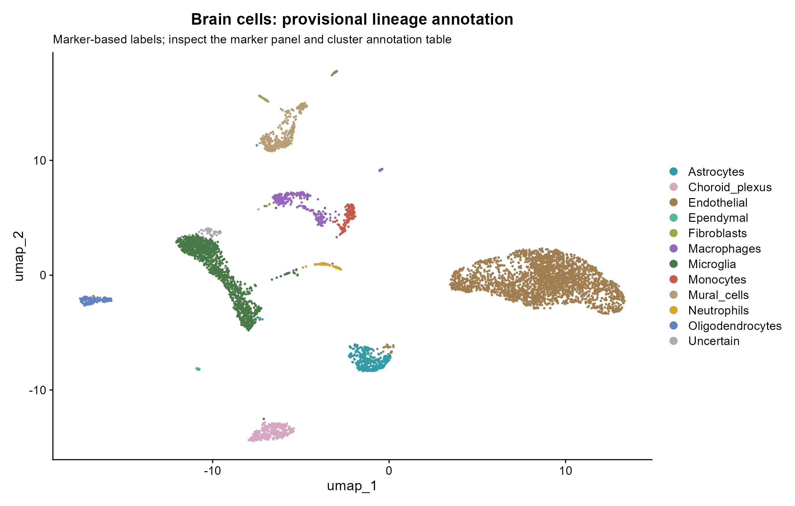

# 用 R 从零分析小鼠脑梗死单细胞数据

一个已经实际运行、附图表结果的中文入门项目。使用 GEO **GSE174574**：3 份 Sham（假手术）与 3 份 MCAO（大脑中动脉阻塞，脑缺血后 24 小时）小鼠脑样本。默认每份样本最多分析 1,000 个质控合格细胞，降低内存和运行时间。

**先看 [详细中文教程](docs/中文详细教程.md)，再看 [本次实际结果与解释](results/分析报告.md)。** 教程不介绍 R 的安装，覆盖下载项目、依赖、矩阵含义、每一步分析、读图、表格列名、常见错误和全量运行。所有图均由 R 生成。

本次实际运行：58,528 个下载条形码 → 58,326 个通过质控 → 6,000 个抽样细胞、17 个聚类。小胶质细胞按样本伪 bulk 检验 6,836 个基因；在 FDR < 0.05 且 abs(log2FC) ≥ 1 下，MCAO 较高 548 个、较低 668 个。Spp1/Lpl/Il1b 较高，P2ry12/Tmem119 较低，Apoe 未达联合门槛。数据与对象一致性检查已通过；详见 [核查记录](results/logs/verification.txt)。

## 先看结果



每个点是一枚细胞；颜色是根据多个标志基因作出的暂定细胞类型。图中位置不是脑内空间坐标。注释证据见 [标记点图](results/figures/09_marker_dotplot.png) 和 [注释表](results/tables/cluster_annotation.csv)。


差异分析以每个样本的小胶质细胞原始计数总和为一份文库，使用 **edgeR 伪 bulk，3 vs 3 样本**，避免将同一动物的细胞当成独立重复。正 log2FC 表示 MCAO 较高。筛选条件为 FDR < 0.05 且 |log2FC| ≥ 1。

## 快速复现

1. 在本页点 **Code → Download ZIP** 并解压，或 `git clone https://github.com/onlyone-hash/stroke-scrna-seurat-tutorial.git`。
2. 双击 `stroke-scrna-seurat-tutorial.Rproj` 用 RStudio 打开，工作目录应是含 `run.R` 的文件夹。
3. 首次运行，在 R 控制台执行：

```r
# 与本项目记录的版本尽量一致，推荐 R 4.4.1。
options(repos = c(CRAN = "https://cloud.r-project.org"), timeout = 900)
if (!requireNamespace("renv", quietly = TRUE)) install.packages("renv")
renv::restore(project = getwd(), prompt = FALSE)
renv::load(project = getwd())
source("run.R", encoding = "UTF-8")
```

没有 RStudio 也可以先用 `setwd("你的项目绝对路径")`，再执行上面代码；命令行可在项目根目录运行 `Rscript --vanilla run.R`，但应先在使用的 R 会话中恢复/加载依赖。严格恢复后的命令行方法见教程。

仅想快速试跑、接受包版本可能不同，可以直接 `source("run.R", encoding = "UTF-8")`：脚本会检查依赖并只安装缺少的包，不自动升级已有包。脚本结束会更新当前环境的 `renv.lock`；若要保留本仓库的基准锁文件，请先备份，或在项目副本中运行。

首次需从 NCBI 下载约 **263 MB（251 MiB）** 的 18 个表达矩阵相关压缩文件；这不包含安装 R 包需要的下载量。每个文件下载成功后缓存，后续运行校验 SHA256 并复用。建议 16 GB 内存；总耗时依网络和电脑而变，请以日志为准。

## 分析做了什么

| 步骤 | 输入与方法 | 你会得到什么 |
| --- | --- | --- |
| 下载 | 官方 GEO SOFT 元数据与 18 个 HTTPS 文件 | 样本表、来源和 SHA256 |
| 质控 | 每个细胞的基因数、UMI 数、线粒体比例 | 过滤前分布、过滤后散点图、每细胞筛选记录 |
| 简化 | 每个样本合格细胞中固定种子抽样 | 6 份样本均保留，默认最多 6,000 个细胞 |
| 表达处理 | LogNormalize、2,000 高变基因、ScaleData、PCA | 可比较的表达数据和 PCA 肘图 |
| 聚类 | PC1–20，Louvain，resolution 0.4 | 聚类 UMAP、样本 UMAP、分组 UMAP |
| 细胞注释 | 经典标记组合评分，保留不确定标签，人工复核证据 | 细胞类型图、marker dot plot、FeaturePlot、细胞组成 |
| 标记发现 | 每簇与其他细胞比较，探索性 Wilcoxon | 各簇 top10 标记和完整候选表 |
| 疾病比较 | 同一谱系按样本汇总原始 UMI，edgeR QL | 小胶质细胞火山图、热图、样本表达点图、样本 PCA |

完整分析参数在 [config/analysis_config.R](config/analysis_config.R)。本教程不运行细胞通信、拟时序、转录因子网络等进阶分析。

## 项目文件

```text
run.R                               一键运行入口
stroke-scrna-seurat-tutorial.Rproj    RStudio 项目
renv.lock                           实际运行时的 R 包版本
DESCRIPTION                         显式依赖清单
config/analysis_config.R             阈值、种子、抽样数、聚类参数
config/samples.tsv                  6 份样本与 GSM 对应
config/input_checksums.tsv          基准输入 SHA256
config/annotation_overrides.tsv     如有：人工复核及理由
scripts/00_setup.R                  依赖和绘图设置
scripts/01_download.R               下载、元数据、完整性校验
scripts/02_preprocess.R             质控、抽样、标准化、降维和聚类
scripts/03_annotation.R             注释、标记、细胞组成图
scripts/04_pseudobulk.R             小胶质细胞 3 vs 3 差异分析
scripts/05_report.R                 生成报告和环境记录
scripts/verify_results.R            结果一致性检查
docs/中文详细教程.md                 完整教学文档
docs/结果文件字典.md                 图与 CSV 的用途及字段说明
results/分析报告.md                  实际结果及解释
results/figures/                     15 组图：PNG + PDF
results/tables/                      数据来源、质控、细胞注释、差异统计
results/logs/                       实际运行日志、sessionInfo、参数
data/raw/                           运行后下载；不上传 GitHub
results/objects/                    运行后生成 RDS；不上传 GitHub
```

原始数据和较大的 Seurat RDS 对象没有提交到 GitHub；`run.R` 会从官方源获取输入并在本地重建对象。仓库包含已经运行出的全部展示图和结果表。PNG 用于预览，PDF 用于矢量编辑和放大查看。

## 使用边界

这是可复现的**教学和探索性再分析**。默认抽样、粗粒度标记注释、未做专门双细胞检测/环境 RNA 校正/批次整合，每组也只有 3 个样本。细胞组成不能等同于组织的绝对细胞数，表达差异不能证明因果、蛋白变化或药物疗效。完整限制与读图方法已写入教程和结果报告。

## 数据引用与许可

数据：[NCBI GEO GSE174574](https://www.ncbi.nlm.nih.gov/geo/query/acc.cgi?acc=GSE174574)。原始研究：Zheng K, et al. *Single-cell RNA-seq reveals the transcriptional landscape in ischemic stroke*. Journal of Cerebral Blood Flow & Metabolism. [DOI:10.1177/0271678X211026770](https://doi.org/10.1177/0271678X211026770)。

方法参考：[Seurat 官方教程](https://satijalab.org/seurat/articles/pbmc3k_tutorial)、[edgeR 用户指南](https://bioconductor.org/packages/release/bioc/vignettes/edgeR/inst/doc/edgeRUsersGuide.pdf)。

本仓库自行编写的代码与教学文本采用 [MIT 许可](LICENSE)。公开数据仍归原作者/原数据库所有，使用数据时请引用原始研究；MIT 许可不替原始数据赋予新的许可。未复制原论文图片。
