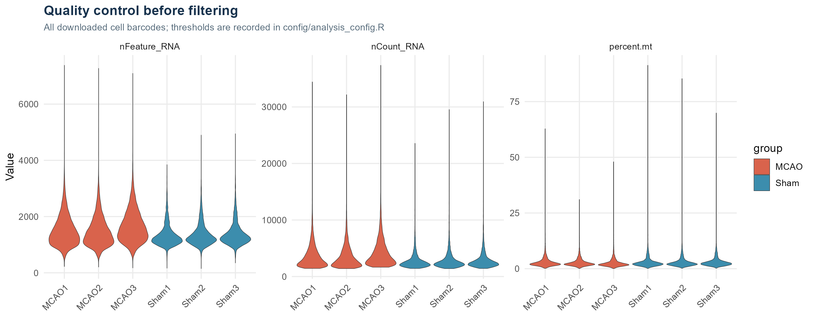
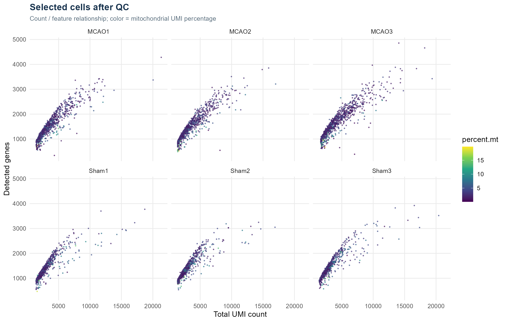
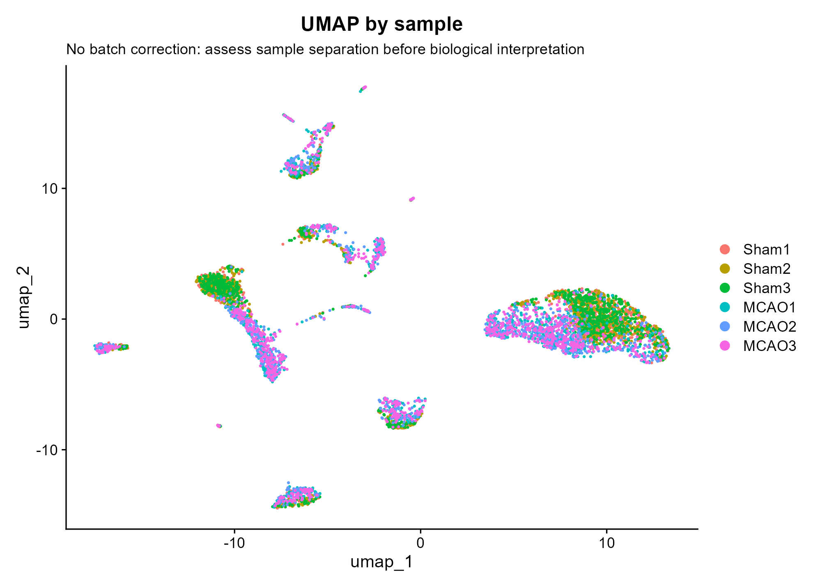
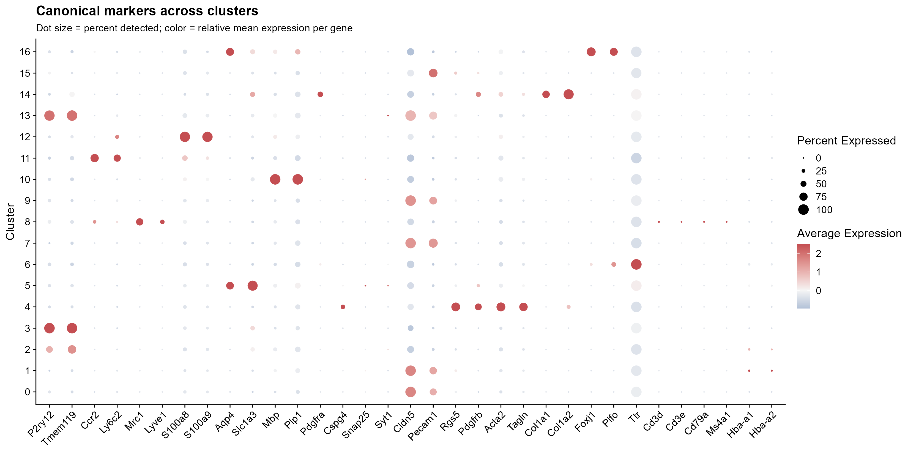
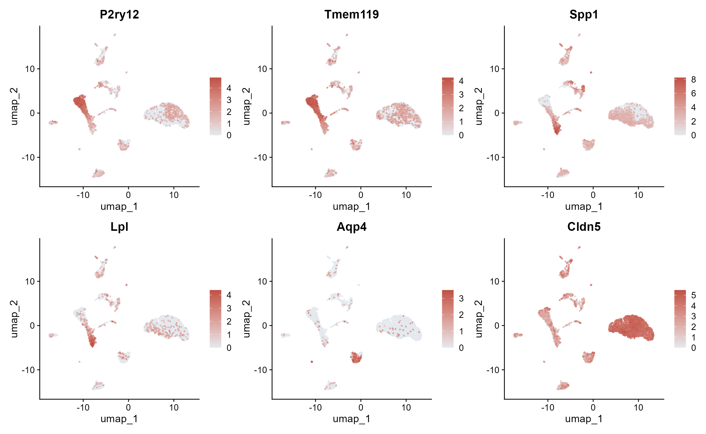
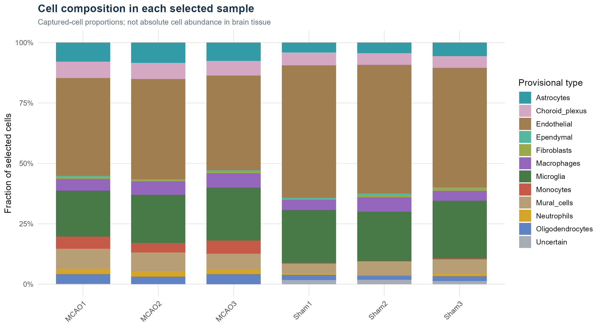
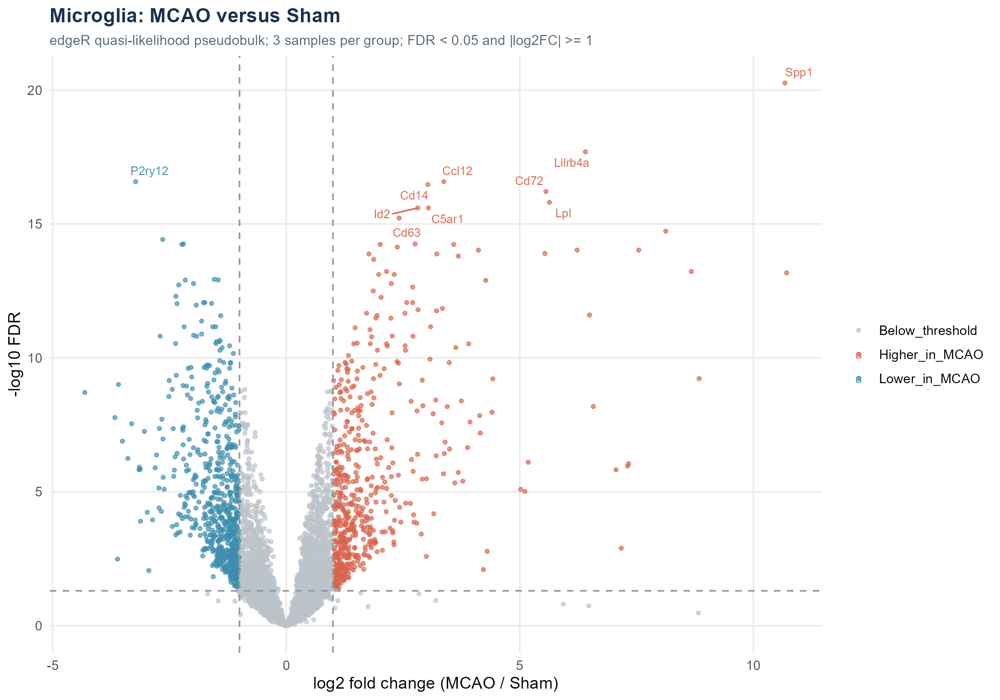
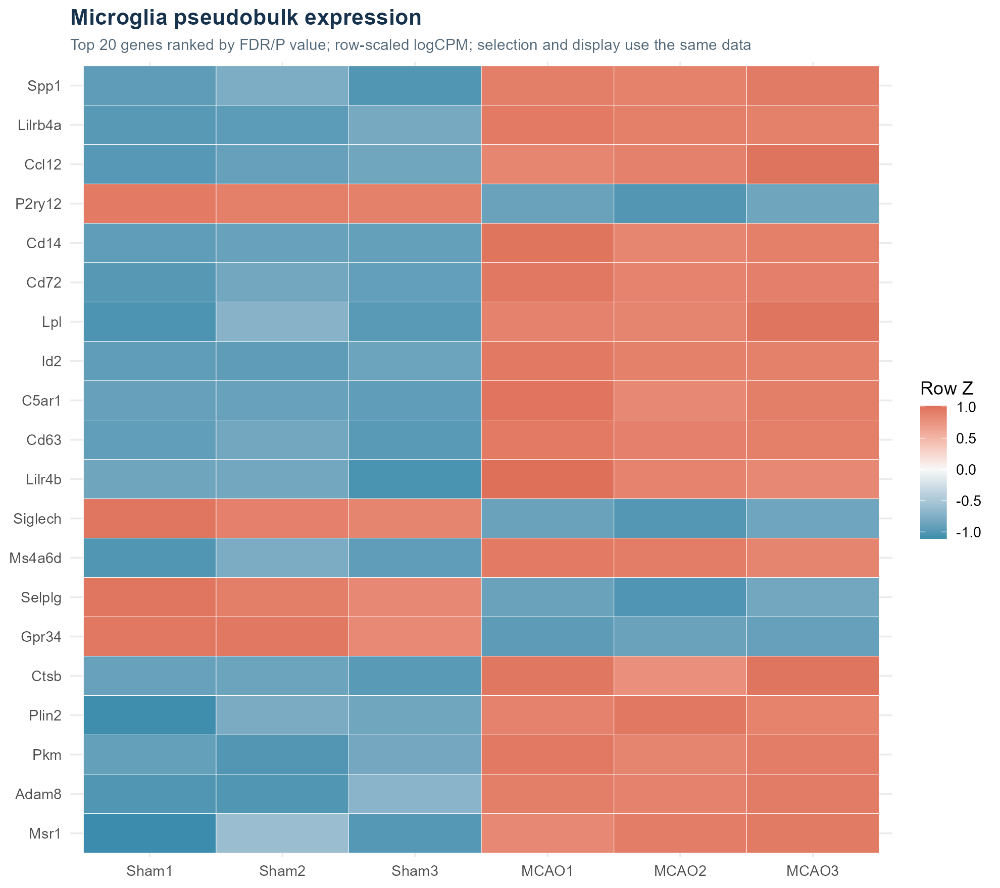
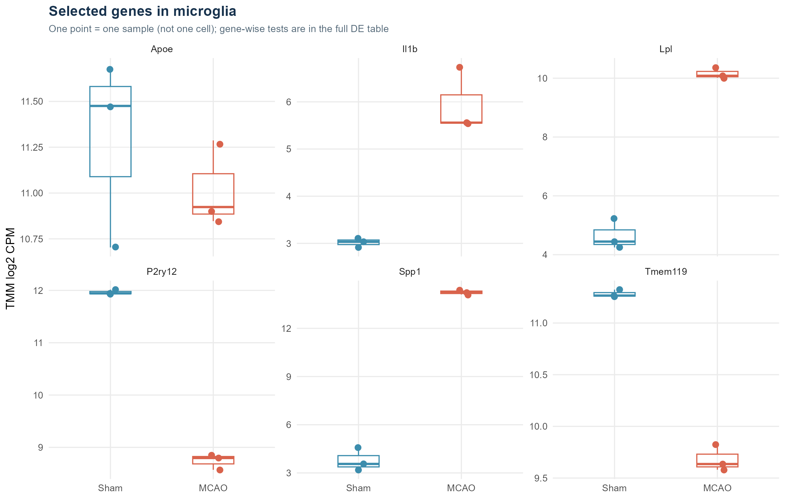

# 小鼠脑缺血单细胞 RNA 测序：从文件到生物学解释

本教程假定你已经安装 R；不需要先会 Linux、Python 或测序原始数据处理。所有正式分析和图片都用 R 完成。你要做的是下载项目、准备 R 包、运行代码，然后根据证据解释结果。

这是一份**公开数据再分析**。我们没有重新取样或做测序实验，而是从原作者已经生成的基因 × 细胞 UMI 计数矩阵开始。这样可以在普通电脑上学习单细胞分析的核心步骤，不必下载 FASTQ 或运行 Cell Ranger。

建议阅读顺序：先读第 1–4 节理解数据，再按第 5–7 节跑通，最后对着结果读第 8–16 节。

## 1. 我们想回答什么

研究对象是小鼠缺血性脑卒中模型，常用中文叫脑缺血或脑梗死模型。这里的 MCAO 指大脑中动脉阻塞。Sham 是假手术对照，接受相应手术处理但没有同样的血管阻断。

本教程问三个较小的问题：

1. 下载到的细胞中有哪些大类细胞，可以用什么标记识别？
2. Sham 与 MCAO 的捕获细胞组成和表达图谱呈现什么差别？
3. 在同一类细胞——小胶质细胞——内部，哪些基因在 MCAO 样本中的 RNA 表达较高或较低？

第一个是“谁在这里”，第二个是“观察到的组成如何”，第三个是“同类细胞的状态如何”。细胞组成改变与同类细胞内表达改变是两件事；把所有细胞混起来比较，会把两种效应混在一起。

## 2. 数据来自哪里，为什么选择它

官方入口：[GSE174574](https://www.ncbi.nlm.nih.gov/geo/query/acc.cgi?acc=GSE174574)。原始研究：[Zheng 等，Single-cell RNA-seq reveals the transcriptional landscape in ischemic stroke](https://doi.org/10.1177/0271678X211026770)。论文全文可从 [PMC](https://pmc.ncbi.nlm.nih.gov/articles/PMC8721774/) 阅读。

这里有 6 份小鼠脑样本，论文描述为 Sham 与 MCAO 后 24 小时各 3 只动物的左侧脑半球，使用 10x 单细胞转录组技术。选择它是因为有清楚的对照和三个样本重复，官方提供计数矩阵，能省掉大规模比对工作。下载文件由 R 从 GEO 官方 HTTPS 地址获取。

| 本项目样本名 | GEO 样本编号 | 原始标题 | 分组 |
| --- | --- | --- | --- |
| Sham1 | GSM5319987 | Brain Sham rep1 | Sham |
| Sham2 | GSM5319988 | Brain Sham rep2 | Sham |
| Sham3 | GSM5319989 | Brain Sham rep3 | Sham |
| MCAO1 | GSM5319990 | Brain MCAO rep1 | MCAO，24 h |
| MCAO2 | GSM5319991 | Brain MCAO rep2 | MCAO，24 h |
| MCAO3 | GSM5319992 | Brain MCAO rep3 | MCAO，24 h |

**一个元数据细节：** GEO 中三个 MCAO 样本的 `treatment` 字段都写成了 `MCAO1`，但样本标题和文件名分别是 rep1、rep2、rep3。本项目依据标题、GSM 和文件名保留三个样本，而没有按这个错误的 treatment 字段合并。自动下载的 `source_summary.txt` 保留了原始信息供检查。

本项目的抽样分析不等于原论文全量分析，因此不要求得到原文完全相同的聚类数、细胞数或差异基因。原作者的分群也不是本项目的标准答案；应比较明确的谱系标记和分析条件。

## 3. 单细胞测序到底测到了什么

### 3.1 先把“细胞、基因、RNA”分开

细胞是分析单位之一，例如一枚小胶质细胞。基因是基因组中的功能序列，这里通常用名称表示，例如 `Aqp4`。RNA 是基因表达过程中的分子产物之一；单细胞 RNA 测序记录某个细胞中捕获到了哪些 RNA，以及相应计数。

因此，本项目测的是**转录表达**。它不是 DNA 突变检测，不直接测蛋白数量，也不能仅凭 RNA 就确定某种功能真的增强或减弱。`Spp1` RNA 较高与“SPP1 蛋白已经导致某种损伤”之间仍有需要实验检验的距离。

### 3.2 Barcode 是谁，UMI 是多少

- **Cell barcode（细胞条形码）**：用于把测序记录归到某个液滴/细胞的标签。不同样本可能出现相同 barcode，因此脚本加上样本前缀，例如 `Sham1_AAAC…`，避免重名。
- **UMI（唯一分子标识）**：用于减少 PCR 扩增重复计数。矩阵里的一个数更接近捕获并识别到的分子计数，不等同于读段数，也不是细胞内 RNA 分子的完整普查。
- **Dropout/未检出**：一个基因的计数为 0，可能真的是没有表达，也可能是表达较低但没捕获到。因此不能凭单个细胞的一次 0 值就断言这个基因绝对不存在。

### 3.3 基因 × 细胞矩阵是什么

下面只是用于解释格式的玩具例子，**不是本项目的真实结果**：

| 基因 | 细胞 A | 细胞 B | 细胞 C |
| --- | --- | --- | --- |
| P2ry12 | 6 | 0 | 1 |
| Aqp4 | 0 | 8 | 0 |
| Spp1 | 1 | 0 | 10 |

一行是一个基因，一列是一个细胞，数值是 UMI 计数。细胞 A 的 `P2ry12` 被检出 6 个计数；这还不足以单凭一个基因就把它定为小胶质细胞，需要结合多种标记。

矩阵有很多 0，适合保存成**稀疏矩阵**，只记录非零元素的位置和值。不要用 `as.matrix()` 把完整大矩阵全部变成普通矩阵，也不要尝试在 Excel 中打开整个表达矩阵。

### 3.4 每个样本为什么有三个文件

以 Sham1 为例：

| 文件 | 保存的内容 |
| --- | --- |
| `GSM5319987_sham1_matrix.mtx.gz` | 稀疏计数矩阵；Matrix Market 格式 |
| `GSM5319987_sham1_genes.tsv.gz` | 矩阵行对应的基因 ID/基因名称 |
| `GSM5319987_sham1_barcodes.tsv.gz` | 矩阵列对应的细胞 barcode |

`.gz` 表示压缩；R 可以直接读取，不必手工解压。`matrix.mtx` 中非零记录的第一、第二个数字分别是行号和列号，第三个是计数。文件头还记录行数、列数和非零值数量。三个文件必须配套，不能把 Sham1 的矩阵与 Sham2 的 barcode 放在一起。

### 3.5 一个 Seurat 对象装了什么

Seurat 对象像一个容器，同时保存表达矩阵、每细胞信息、降维坐标和聚类。

| 位置/名称 | 含义 | 在本项目中的用途 |
| --- | --- | --- |
| RNA `counts` layer | 原始 UMI 计数 | 质控、按样本累加做伪 bulk |
| RNA `data` layer | log 标准化表达 | FeaturePlot、DotPlot、标记发现 |
| RNA `scale.data` layer | 按基因标准化的值 | PCA；只对高变基因计算 |
| `obj[[]]` | 每细胞 metadata | 样本、组别、质控、cluster、cell_type |
| `obj[["pca"]]` | PCA 低维表示 | 邻居图与聚类的输入 |
| `obj[["umap"]]` | UMAP 二维坐标 | 可视化 |

Seurat v5 采用 layer。合并多个样本后可能存在多个 counts layer；本项目使用 `JoinLayers()`，因此后续取 `counts` 和 `data` 时不需要猜选哪一层。

## 4. 为什么要做一个“简单版”

下载数据仍然包括全部 6 份样本，但只在**每份样本完成质控之后**随机抽取最多 1,000 个细胞。这样最多分析 6,000 个细胞，并保留全部 6 个生物学样本。

优点是普通电脑更容易完成降维、聚类和作图。代价是稀有细胞容易少见或缺失，亚群边界可能改变，差异检验的功效也会降低。不能拿这个抽样版本声称已经完整刻画所有细胞亚型。

抽样不是把 MCAO 和 Sham 分别挑选成想要的细胞类型。脚本在每个样本的合格细胞中均匀随机抽取；同一份样本的每枚合格细胞有相同的抽中机会。固定 `seed = 20261026`，且每个样本使用 `seed + 样本序号`。抽中哪些 barcode 都写入表格，可以核对。

## 5. 下载和打开项目

### 5.1 不使用 Git 的方式

1. 打开 [项目 GitHub 首页](https://github.com/onlyone-hash/stroke-scrna-seurat-tutorial)。
2. 点击绿色 **Code** 按钮，再点击 **Download ZIP**。
3. 解压到你有写入权限的文件夹。不要在 ZIP 内直接运行。
4. 双击 `.Rproj` 文件。如果没有自动打开 RStudio，也可以先打开 RStudio，再用 **File → Open Project** 选择它。
5. 在 R 控制台运行 `getwd()`；应能在当前目录找到 `run.R`、`scripts`、`config`。

### 5.2 使用 Git 的方式

```bash
git clone https://github.com/onlyone-hash/stroke-scrna-seurat-tutorial.git
cd stroke-scrna-seurat-tutorial
```

上面是终端命令，不是 R 命令。下载完成后仍然可以用 `.Rproj` 打开。

### 5.3 没有 RStudio

在 R 里设置自己的项目绝对路径。例如 Windows：

```r
setwd("D:/my_projects/stroke-scrna-seurat-tutorial")
stopifnot(file.exists("run.R"))
```

这里的路径只是例子，必须改成你自己的位置。Windows 的 R 字符串建议用 `/`；如果用反斜杠需要写成 `\\`。不要照抄作者电脑路径。

## 6. 准备 R 包并运行

### 6.1 优先：恢复本项目的版本

本次实际运行使用的 R 与包版本见 [sessionInfo](../results/logs/sessionInfo.txt)、[包版本表](../results/tables/package_versions.csv) 和根目录 `renv.lock`。建议使用 R 4.4.1，操作系统差异仍可能带来数值或绘图差别。

在项目根目录的 R 控制台执行：

```r
options(repos = c(CRAN = "https://cloud.r-project.org"), timeout = 900)
if (!requireNamespace("renv", quietly = TRUE)) install.packages("renv")
renv::restore(project = getwd(), prompt = FALSE)
renv::load(project = getwd())
source("run.R", encoding = "UTF-8")
```

`renv::restore()` 依据锁文件恢复依赖，通常会在项目的隔离库中安装包；`renv::load()` 让当前 R 会话使用该项目库。**只 restore 而没有 load，可能仍然用到你系统库中的其他版本。** 此项目没有自动加载 `.Rprofile`，所以明确执行这一步。

这里恢复的是软件环境，不是下载测序数据。测序数据由 `run.R` 的下载步骤获取。包需要从 CRAN、Bioconductor 或锁文件记录的来源下载；第一次安装可能比正式分析还慢。Windows 上能获得对应二进制包时不需要编译器；旧版本或某些依赖只提供源码时可能需要相应构建工具。

### 6.2 更快试跑：使用你已经安装的包

如果只是先学习流程，可以直接运行：

```r
source("run.R", encoding = "UTF-8")
```

`00_setup.R` 只安装缺少的包。已有包不升级，但版本不匹配时仍可能报错或出现不同结果。运行末尾会对当前实际环境生成 `renv.lock`，所以要保留仓库基准版本，请先复制项目或备份基准锁文件。

主要包的分工：

| 包 | 做什么 |
| --- | --- |
| Seurat、SeuratObject | 单细胞对象、标准化、降维、聚类、标记 |
| Matrix | 高效存取稀疏计数矩阵 |
| ggplot2、patchwork、ggrepel | 作图、拼图、文字标签排布 |
| ragg | 输出清晰的 PNG |
| edgeR、limma、statmod | 样本层面的计数建模和差异分析 |
| data.table | 快速输出表格 |
| digest | 计算输入文件 SHA256 |
| renv | 记录和恢复包版本 |

### 6.3 命令行方式

项目已恢复依赖后，可在项目根目录运行：

```bash
Rscript --vanilla -e "renv::load(project=getwd()); source('run.R', encoding='UTF-8')"
```

若 `Rscript` 不在系统 PATH 中，Windows PowerShell 可以显式指定你电脑上的 R，例如：

```powershell
& 'D:\R\R-4.4.1\bin\Rscript.exe' --vanilla -e "renv::load(project=getwd()); source('run.R', encoding='UTF-8')"
```

把 R 路径改成你自己的。实际交付是在用户电脑 `D:/R/R-4.4.1/bin/Rscript.exe` 下运行的，分析代码本身没有依赖这个绝对路径。

### 6.4 怎么判断成功

控制台依次出现 `00_setup.R` 到 `05_report.R`，最终输出 `Completed`。确认以下内容已经生成：

```r
file.exists("results/分析报告.md")
length(list.files("results/figures", pattern = "[.]png$"))
source("scripts/verify_results.R", encoding = "UTF-8")
```

默认流程输出 15 张 PNG 和对应 15 份 PDF，以及多个 CSV、RDS、日志。仅有第一张图不代表整个流程成功。根目录中附带的是交付时已经运行出的结果；重新执行会覆盖对应文件，所以比较不同参数前先复制项目。

## 7. 下载步骤具体做什么

`01_download.R` 先下载 GEO 的 SOFT 元数据，再从其中取得 18 个官方文件 URL（6 样本 × 3 文件）。下载先写 `.part` 临时文件，成功后才改成正式文件名；网络失败会有限重试。

每个文件都会计算 SHA256，与仓库的 `config/input_checksums.tsv` 对比。SHA256 可以看作文件内容的指纹：同名文件不一定相同，指纹相同才说明字节内容与本项目基准一致。校验不一致时应停止查原因，不要为了跑通而删除基准校验表。

下载缓存位于 `data/raw/`。后续运行发现已有完整文件会复用，仍进行指纹检查。GitHub 不保存这些大文件，避免仓库膨胀，也保持下载来源明确。

若 R 下载受网络影响，可打开 [官方补充文件目录](https://ftp.ncbi.nlm.nih.gov/geo/series/GSE174nnn/GSE174574/suppl/) 或各 GSM 页面手动下载。GEO 提供的 `GSE174574_RAW.tar` 是包含处理后矩阵的打包文件；文件名中的 RAW 不代表我们从 FASTQ 原始读段开始分析。解包后将 18 个 `.gz` 文件直接放在 `data/raw/`，保持文件名不变，再运行脚本。

## 8. 质控：为什么有些细胞要去掉

### 8.1 三个基本指标

| 指标 | 计算方式 | 需要警惕什么 |
| --- | --- | --- |
| `nCount_RNA` | 一枚细胞所有基因的 UMI 总和 | 很低可能信息不足；很高可能是较大细胞或双细胞 |
| `nFeature_RNA` | 一枚细胞中计数 > 0 的基因数 | 很低可能损伤/空滴背景；很高也可能双细胞 |
| `percent.mt` | 线粒体基因 UMI / 总 UMI × 100 | 很高可能与损伤或应激有关，也受细胞类型影响 |

脚本使用 `^mt-`（不区分大小写）匹配小鼠线粒体基因，并检查匹配数量，防止把百分比全算成 0。`nFeature` 不是“整个细胞真的只有这些基因”，只是本次被检出的数量。

本教程的阈值是：

```r
nFeature_RNA >= 200
nFeature_RNA <= 6000
nCount_RNA   <= 25000
percent.mt  <= 20
```

这是为本数据的入门分析选择的可审阅阈值，**不是所有单细胞实验的通用标准，也不是原论文参数的完整复制**。参数集中在 `config/analysis_config.R`。脑缺血样本可能存在真实受损细胞，线粒体阈值过严会删掉某些生物学状态，因此要看过滤比例和样本间差别。

### 8.2 怎么读质控图



小提琴越宽，表示该范围内细胞较多。三格分别显示基因数、UMI 数和线粒体比例，纵轴范围不同。比较同一个指标在各样本中的分布，检查是否某份样本整体偏移。



每个点是最后选入分析的一枚细胞。横轴 UMI 数、纵轴检出基因数，颜色是线粒体比例。看两者是否合理相关，是否仍有偏离群体的点。

`qc_summary.csv` 给出每样本下载条形码数、合格数和抽样后分析数。`qc_all_cells.csv` 保留每个下载条形码的 `pass_qc` 和 `selected`，可以区分“质控被删掉”与“合格但未抽中”。

**没有做的事：** 专门的双细胞检测与环境 RNA 校正。高计数阈值只能排除部分可疑细胞，不能代替这些方法。后续若见混合谱系标记，应首先考虑双细胞、污染和注释边界。

## 9. 标准化、高变基因与 PCA

### 9.1 为什么不能直接比较原始计数

假设两个相似细胞，一个总共测到 1,000 个 UMI，一个测到 5,000 个 UMI。后者许多基因计数都较高，可能只是测序深度差别。

本项目使用 Seurat 的 `LogNormalize`：

```text
标准化值 = log(1 + 某基因原始 UMI / 该细胞总 UMI × 10000)
```

这里 `log` 为自然对数。这样减轻总计数差异，但依然依赖归一化假设，并不保证消除全部技术或生物学混杂。**差异分析时不把这种 log 值交给 edgeR；edgeR 使用原始计数汇总。**

### 9.2 为什么选择 2,000 个高变基因

不是所有基因都同样有助于区分细胞。`FindVariableFeatures(selection.method = "vst")` 寻找细胞间变化相对大的基因，挑选 2,000 个用于主要结构分析。高变基因不等于疾病差异基因：它们可能仅反映不同细胞类型的身份差异。

`ScaleData` 对这些基因逐基因居中和标准化，再把值交给 PCA。它不意味着原始 UMI 被改写；原始 `counts` 仍保留。

### 9.3 PCA 是压缩信息

原本每个细胞有很多基因维度。PCA 用若干主成分概括主要变化，降低后续邻居图构建的复杂度。本项目计算 30 个 PC，并使用 PC1–20 建图、聚类和 UMAP。

`03_pca_elbow.png` 显示各 PC 的标准差。越往后变化通常越小，“肘部”可帮助选择维数，但不存在适用于所有数据的固定最优点。本项目把维数作为明确参数，供教学和敏感性分析使用。

## 10. 聚类与 UMAP：一簇不一定是一种细胞

代码用前 20 个 PC 构建近邻图，然后用 Louvain 方法聚类，`resolution = 0.4`。分辨率调高通常更容易得到细分簇，但簇数没有生物学上的唯一正确答案。

Cluster 0、1、2 等只是编号，不能凭数字判断细胞类型。同一种细胞可能因活化、细胞周期、应激或技术影响被分成多簇；一个簇也可能混有多种细胞。

UMAP 把高维相似性投射成二维，方便看图：

- 近邻关系常有参考意义，但簇间的远近和面积不宜作定量生物学解释。
- 横纵轴不是实际空间位置，也不是疾病进程。
- 分开的两簇不能自动解释为分化关系或“变成了另一种细胞”。
- 同一坐标分别按 cluster、sample、group 上色，才能看到图形结构与样本来源的关系。



若某簇几乎只来自单个样本，可能有真实生物差异，也可能受批次或样本质量影响。本教程为简化没有执行 Harmony 等整合；不会仅为了把两组混合而强行纠正，因为治疗组别本身也可能驱动真实差异。若有明确技术批次，应在合理设计下做整合，并与未整合结果比较。

## 11. 细胞类型里面都是什么

我们使用多个标记组合提供**暂定粗谱系注释**。下面是读图时常见名称；面板中列出某类细胞不意味着本次抽样一定捕获到了该类细胞。

| 图中名称 | 中文解释 | 本项目关注的标记举例 | 容易误解的地方 |
| --- | --- | --- | --- |
| Microglia | 小胶质细胞，脑内驻留髓系免疫细胞 | P2ry12、Tmem119、Cx3cr1、Hexb、C1qa | 活化后经典身份标记可能减弱，与其他髓系细胞共享基因 |
| Monocytes | 单核细胞相关谱系 | Ccr2、Ly6c2、Plac8、Lyz2 | Lyz2 不只在单核细胞表达，不能单基因定型 |
| Macrophages | 巨噬细胞相关谱系，可能包含边界相关群 | Mrc1、Lyve1、Pf4、F13a1 | 本教程不精细区分每一种脑边界巨噬细胞 |
| Neutrophils | 中性粒细胞相关谱系 | S100a8、S100a9、Retnlg、Ly6g | 炎症标记可能与其他髓系细胞部分共享 |
| Astrocytes | 星形胶质细胞，参与稳态、代谢支持及神经血管界面 | Aqp4、Slc1a3、Aldoc、Gja1 | Aqp4 的 RNA 变化不直接证明水通道蛋白定位或水肿机制 |
| Oligodendrocytes | 少突胶质细胞，参与髓鞘形成与维持 | Mbp、Plp1、Mog、Mag | 髓鞘相关 RNA 也可能形成环境污染 |
| OPC | 少突胶质前体细胞 | Pdgfra、Cspg4、Olig1、Olig2 | 前体标记不等于已经追踪到真实分化轨迹 |
| Neurons | 神经元相关谱系 | Snap25、Syt1、Rbfox3 | 成人脑细胞消化流程可能低估脆弱神经元，不应强行找出一大群 |
| Endothelial | 血管内皮细胞 | Cldn5、Pecam1、Kdr、Esam | 粗注释没有区分动脉、静脉、毛细血管 |
| Pericytes | 周细胞，血管壁相关细胞 | Rgs5、Pdgfrb、Kcnj8、Abcc9 | 与平滑肌有共享标记，边界可能连续 |
| Smooth_muscle | 血管平滑肌相关谱系 | Acta2、Tagln、Myh11、Cnn1 | Acta2 不是专属于一种细胞 |
| Mural_cells | 血管壁细胞粗合并类 | 同时具有 Rgs5/Pdgfrb 和 Acta2/Tagln/Myh11 | 本次 cluster 4 使用宽标签，不强行区分周细胞与平滑肌 |
| Fibroblasts | 成纤维细胞相关谱系 | Col1a1、Col1a2、Dcn、Lum | 血管周围细胞的细分仍需额外证据 |
| Ependymal | 室管膜细胞，常见纤毛相关标记 | Foxj1、Pifo、Ccdc153 | 不等同于所有上皮细胞 |
| Choroid_plexus | 脉络丛上皮相关谱系 | Ttr、Folr1、Aqp1、Otx2 | 需联合多个标记，Ttr 的游离 RNA 也可能污染其他群 |
| T_NK_cells | T / NK 淋巴细胞粗合并类 | Cd3d、Cd3e、Trbc2、Nkg7、Ncr1 | 为降低复杂度，没有进一步区分 T 与 NK 亚型 |
| B_cells | B 淋巴细胞相关谱系 | Cd79a、Ms4a1、Cd79b | Cd74 也可见于其他抗原呈递细胞 |
| Erythroid | 红系相关细胞 | Hba-a1、Hba-a2、Hbb-bs、Alas2 | 血红蛋白 RNA 也可能是背景污染 |
| Uncertain | 证据不够或多个候选接近 | 看候选评分、top markers、点图 | 这是保留不确定性，不能强行套上一个漂亮名字 |

这些解释是帮助理解常见谱系标记；最终注释还要回到本数据的表达证据。参考原始研究的细胞分类，以及 [Seurat 官方关于标记与注释的示例](https://satijalab.org/seurat/articles/pbmc3k_tutorial)。

### 11.1 自动候选注释怎么算

`03_annotation.R` 将候选标记的 log 标准化表达逐基因转成 Z 分数，计算每个细胞的标记集合平均值，再取同一 cluster 的均值。对每簇比较所有候选类型的得分。

默认要求最高分 ≥ 0.25，且与第二名差值 ≥ 0.15；不满足就暂记 `Uncertain`。这两个门槛是本教学方案的启发式规则，分数和差值**不是概率或置信区间**，不能称“准确率 95%”。跨基因 Z 分数也会受本次抽样细胞组成影响。

人工复核时，如需要修改标签，把依据写入 `config/annotation_overrides.tsv`：

```text
cluster	cell_type	reason
```

这里只展示表头，数据行应根据你真正观察到的 marker 填写；不要照搬别人的 cluster 编号。脚本只接受本次确实存在的 cluster，并将复核理由写入结果表。

本仓库已有两条实际复核记录：cluster 4 同时有周细胞/平滑肌标记，改为 `Mural_cells`；cluster 13 同时有强小胶质与内皮标记，改为 `Uncertain` 并排除在小胶质细胞差异分析之外。各标记的实际检出比例、均值保存在 `cluster_marker_evidence.csv`。这不是宣布 cluster 13 一定是双细胞，而是避免在证据不足时作过度精细判断。

本次还观察到 `Ttr` 在多个非脉络丛谱系中普遍检出，提示背景 RNA 等信号值得关注。因此本项目依赖多标记组合，不把所有 `Ttr` 阳性细胞都称为脉络丛细胞；未执行污染校正仍是结果的重要限制。

### 11.2 DotPlot 怎么看



横轴是基因，纵轴是簇。点越大，表示该簇中检测到该基因的细胞比例越高；点颜色表示该基因在不同簇的相对平均表达。**颜色做过按基因的缩放，不能把不同基因同一颜色理解为相同分子数。**

先找成套标记是否一致，再看竞争谱系的标记是否很低。例如某簇若 `P2ry12` 与 `Tmem119` 较高，且不是典型 `Ccr2/Ly6c2` 群，就更支持小胶质细胞。不能凭一个点、一个最强基因或 UMAP 位置完成注释。

`cluster_top10_markers.csv` 通过簇对其余细胞的探索比较列出高表达候选。它的细胞层面 P 值仅帮助发现标记，并非具有动物层面重复支持的疾病检验。因为聚类和标记发现使用同一批数据，也不是独立验证。

### 11.3 FeaturePlot 怎么看



它在同一 UMAP 上用颜色显示指定基因的 log 标准化表达。用于检查 `P2ry12`、`Tmem119` 的小胶质细胞分布，以及 `Spp1`、`Lpl` 等反应相关表达。每张子图的色阶用于自己的基因，不能凭颜色深浅跨基因比较绝对表达量。

## 12. 组成图告诉了什么，没告诉什么



每根柱子是一份样本，分母是该样本进入分析的细胞数，各颜色是暂定细胞类型比例。要先比较同一组的三个样本是否一致，再考虑两组差别。

这些细胞经历了取材、组织消化、活细胞处理、捕获、测序、质控和抽样。某一类细胞更容易损伤或被捕获，会影响比例。所有比例还受到“加起来必须为 100%”的约束：一类增加，其他类即使数量没有变，比例也会相对下降。

因此我们只展示描述性组成，不对细胞数做细胞层面的卡方检验，也不把柱子的差别直接称为组织绝对细胞数显著改变。若要估计真实数量或做组成推断，需要适当的样本层面方法，以及流式/组织学等补充证据。

## 13. 为什么疾病差异用伪 bulk

### 13.1 细胞很多，不代表动物很多

如果同一只动物测了 500 个小胶质细胞，它们共享遗传背景、处理、取材等因素。这 500 个细胞不是 500 只独立动物。

本项目在每份样本内，把所有已注释小胶质细胞的**原始 UMI**按基因相加：

```text
所有 Sham1 小胶质细胞 → 一列 Sham1 小胶质细胞计数
所有 Sham2 小胶质细胞 → 一列 Sham2 小胶质细胞计数
……
所有 MCAO3 小胶质细胞 → 一列 MCAO3 小胶质细胞计数
```

最后得到基因 × 6 样本矩阵。统计单位是 6 份样本，设计为 3 vs 3。不能先把所有 Sham 合成一列、所有 MCAO 合成一列，那样会丢失重复。

每样本至少要有 20 个被注释的小胶质细胞才进入本流程；少于门槛会停止并要求复核/增加抽样数，**不会把缺失样本记作零表达**。这也是为什么保留六份样本比只选一份对照和一份疾病样本更合适。

### 13.2 edgeR 做了哪些步骤

1. `DGEList()` 装入原始伪 bulk 计数。
2. `filterByExpr()` 去掉难以可靠检验的低表达基因。
3. `calcNormFactors(method = "TMM")` 处理文库组成和有效深度差异。
4. `estimateDisp()` 估计样本间计数变异。
5. `glmQLFit()` 拟合 quasi-likelihood 广义线性模型。
6. `glmQLFTest()` 检验 MCAO 与 Sham 的分组系数。
7. 对多个基因的检验进行 FDR 控制，并完整导出结果。

设计是 `~ group`，参考水平固定为 Sham，检验 `groupMCAO`，所以正 `logFC` 表示 MCAO 较高。本教程没有加入性别、批次、配对等协变量，因为这不是一个已提供相应设计信息的模型；不要凭空创建配对关系。

方法依据见 [edgeR 官方用户指南](https://bioconductor.org/packages/release/bioc/vignettes/edgeR/inst/doc/edgeRUsersGuide.pdf) 的多样本单细胞/伪 bulk 内容。这里的样本层面建模仍有每组 n = 3、小样本与注释误差等限制。

## 14. 怎样读差异结果

### 14.1 先认识 CSV 列

| 字段 | 含义 |
| --- | --- |
| `gene` | 基因名 |
| `logFC` | log2(MCAO / Sham) 的模型估计；1 约对应 2 倍，-1 约对应一半 |
| `logCPM` | 平均表达水平的概括，单位为 log2 counts per million |
| `F` | quasi-likelihood F 检验统计量 |
| `PValue` | 未作多重比较校正的 P 值 |
| `FDR` | 多重检验调整后的假发现率指标 |
| `direction` | 按 FDR 和效应量门槛标记的展示类别 |

`FDR < 0.05` 不是“这个基因有 95% 概率是真实的”，也不是“疾病由它导致的概率 95%”。它用于控制大量检验形成的发现集合的错误比例。`Below_threshold` 只表示不满足这里设置的联合阈值，不证明两组完全相同。

本项目用 **FDR < 0.05 且 |log2FC| ≥ 1** 作为展示筛选。完整结果表包含所有被检验基因，不能只保留显著基因而丢掉其他行。

### 14.2 火山图



横轴越向右，MCAO 相对表达越高；越向左，Sham 相对更高。纵轴是 `-log10(FDR)`，越高对应 FDR 越小。两条竖虚线是 ±1，横虚线是 FDR 0.05。

颜色表示联合门槛后的上调/下调/未达门槛。标签只选一部分较靠前的基因，不能认为没标签的基因没有结果。优先查看候选基因在三份样本中是否方向一致，而不是只挑最小 P 值。

### 14.3 热图



每列是一份样本，每行一个基因。这里对每个基因的 logCPM 在六个样本间做 Z 标准化：红色表示这个基因在相应样本中相对较高，蓝色相对较低。

不同基因各自缩放，因此不能说“红色的基因 A 比蓝色的基因 B 表达多”。基因是用同一数据排序选出的，出现组间分离是可视化结果，不能当作另一个独立验证实验。

### 14.4 样本表达点图



一个点是一份样本，组内只有三个点。纵轴是 TMM 标准化后的 log2 CPM；各基因子图可以有不同纵轴范围。

这里预先展示 `P2ry12`、`Tmem119`、`Spp1`、`Lpl`、`Apoe`、`Il1b` 中达到表达过滤标准的基因。选择它们是为了结合身份和反应相关表达练习读图，不保证每个基因都会显著。准确统计值以全表为准，不能给未检验或未显著基因补上星号。

### 14.5 样本 PCA

`15_microglia_pseudobulk_pca.png` 在样本汇总表达上进行 PCA。每个点是一份样本，帮助看离群样本和组间变化；它和每点一枚细胞的 UMAP 含义不同。每组三个点还不足以支持复杂的预测模型。

## 15. 自己加载对象、查一个基因和修改参数

### 15.1 重新载入分析后的对象

RDS 文件在本地运行后生成；仓库没有上传大对象，所以首次需要先完成运行。

```r
library(Seurat)
obj <- readRDS("results/objects/02_annotated.rds")
obj
head(obj[[]])
table(obj$sample_id, obj$cell_type)
```

只取某个 layer：

```r
counts <- LayerData(obj, assay = "RNA", layer = "counts")
norm <- LayerData(obj, assay = "RNA", layer = "data")
dim(counts)    # 基因数 × 选中细胞数
```

### 15.2 查看一个基因

```r
FeaturePlot(obj, features = "Spp1", order = TRUE)
VlnPlot(obj, features = "Spp1", group.by = "group", pt.size = 0)
```

上面的 `VlnPlot` 是**所有选中细胞**混合的描述图，不能替代同一谱系内的样本层面疾病比较。

```r
de <- read.csv("results/tables/microglia_pseudobulk_DE_all.csv",
               fileEncoding = "UTF-8-BOM", check.names = FALSE)
de[de$gene %in% c("Spp1", "P2ry12", "Tmem119"), ]
```

若某基因不在差异表里，先检查是否在表达矩阵中，以及是否被 `filterByExpr` 去掉。没有被检验不等于显著、不显著或无生物学作用。

### 15.3 全量运行

先复制一份项目，避免覆盖教学结果；只在副本里改 `config/analysis_config.R`：

```r
max_cells_per_sample = Inf
```

再从 `run.R` 重新运行。输入下载可以复用，但内存、聚类和标记发现时间会明显增加；不要把“输入文件只有约 263 MB”误认为分析只需 263 MB 内存。

全量运行后的 cluster 编号可能改变。若存在 `annotation_overrides.tsv`，必须重新检查其中的编号与证据，不能沿用旧映射。全量结果应记录到新的目录/仓库版本，保持教学基准可追溯。

### 15.4 参数敏感性练习

可在不同项目副本中比较：线粒体阈值 15% vs 20%，PC1–15 vs PC1–20，resolution 0.3 vs 0.4，每样本 1,000 vs 2,000 个细胞。一次只改一个因素，保留日志和参数。

比较时关注主要谱系标记是否稳定、各样本保留比例、小胶质细胞数量、候选基因方向和样本一致性。不要只追求更多显著基因或更漂亮的 UMAP。

## 16. 常见问题与排查

| 现象 | 先查哪里 | 可操作办法 |
| --- | --- | --- |
| 找不到 `config/analysis_config.R` | `getwd()` | 打开 `.Rproj` 或用 `setwd()` 定位到含 `run.R` 的目录 |
| `there is no package called ...` | 当前项目库与 `renv::status()` | restore 后 load；需要 Bioconductor 包时按锁文件恢复 |
| 下载超时 | 网络、代理、NCBI 是否可访问 | 脚本已设 900 秒；可手动下载 18 文件到 `data/raw/`，再校验运行 |
| SHA256 不一致 | 哪个输入文件异常 | 重新获取该文件；不要删除基准校验以掩盖问题 |
| 中文脚本报 invalid input | R 当前 locale 和文件编码 | Windows 入口会设置进程 UTF-8；保持源码 UTF-8，避免用旧编码重新保存 |
| 包提示 built under R 4.4.3 | 包的构建版本 | 提示本身不等于失败；以实际错误和成功检查为准。更严格时使用兼容的 R/依赖环境 |
| 内存不足、cannot allocate vector | 是否改成全量或把矩阵转 dense | 恢复每样本 1,000，关闭不需要的会话，不把整个 counts 转成普通矩阵 |
| layer 不唯一/找不到 data | 是否跳过 JoinLayers 或 NormalizeData | 按完整脚本顺序运行；不要混用旧版本教程的槽访问方式 |
| 小胶质细胞不足 20/样本 | 细胞注释和每样本计数表 | 先看标记证据；必要时增加每样本抽样数。不要删掉缺失样本后继续声称 3 vs 3 |
| 某类细胞没有出现 | 稀有细胞、取材与抽样 | 面板是候选类型清单，不要求每类都出现；全量和更细注释需单独检查 |
| 复现的 UMAP 轻微旋转或位置不同 | 软件版本、系统、随机算法 | 对照条形码、细胞数、主要标记、统计方向；不要只按像素判断是否复现 |
| 一直没有 `Completed` | `results/logs/analysis.log` 和控制台错误 | 找到最后一个步骤；图生成不等于后续统计与报告已经成功 |

## 17. 怎样负责任地描述本次发现

可用这样的表达框架：

> 我们对 GSE174574 的 3 份 Sham 和 3 份 MCAO 后 24 小时小鼠脑单细胞样本进行教学再分析。按预先记录的质控阈值和固定种子抽样后，使用 Seurat 建图聚类，并结合多个经典标记提供粗粒度细胞注释。小胶质细胞的疾病比较采用样本层面伪 bulk 和 edgeR quasi-likelihood 模型，完整效应与 FDR 见结果表。结果反映该数据及分析条件下的表达关联，仍需全量、敏感性和独立实验验证。

把具体基因的方向和数字从 [实际结果报告](../results/分析报告.md) 或完整差异表填入，不能预先假定某个热门基因一定显著。

不宜从本项目直接声称“已证明某细胞变成另一细胞”“某基因导致脑梗死”“某药物能够治疗脑梗死”“小鼠结果已经适用于人类患者”。它们需要本项目没有提供的研究设计和证据。

## 18. 可复现性检查清单

1. 输入确实是这六份 GSM，并与 18 个 SHA256 基准一致。
2. 保留实际抽中的 cell barcode，使用相同参数与随机种子。
3. 使用与锁文件尽量一致的 R 和依赖，记录 `sessionInfo()`。
4. 每个图都能追溯到表格和 R 脚本，图中文字与统计单位一致。
5. 组间差异以样本作为重复，没有把细胞当成动物。
6. 结果说明包含抽样、暂定注释、未校正因素和适用范围。

运行 `scripts/verify_results.R` 会核对主要数字、文件是否完整、细胞条形码对应、伪 bulk 计数非负整数和 FDR 范围；它验证的是文件/统计结构一致性，不能替代生物学真实性验证。

## 19. 参考资料

- [NCBI GEO：GSE174574](https://www.ncbi.nlm.nih.gov/geo/query/acc.cgi?acc=GSE174574)：输入数据和实验元数据。
- [Zheng 等原始研究](https://doi.org/10.1177/0271678X211026770)：实验背景、细胞类型与原始结果；引用数据时应引用原作者。
- [Seurat 官方 Guided Clustering Tutorial](https://satijalab.org/seurat/articles/pbmc3k_tutorial)：标准预处理、聚类、可视化与标记识别的官方解释。
- [Seurat v5 对象和 layer 说明](https://satijalab.org/seurat/articles/seurat5_essential_commands)：理解 counts/data/layers。
- [edgeR 官方用户指南](https://bioconductor.org/packages/release/bioc/vignettes/edgeR/inst/doc/edgeRUsersGuide.pdf)：计数模型、TMM、QL 和多样本单细胞分析。
- [renv 官方文档](https://rstudio.github.io/renv/): 依赖锁定与恢复。

本教程自行编写，不是上述教程或论文的逐字翻译，未复制原论文图。
